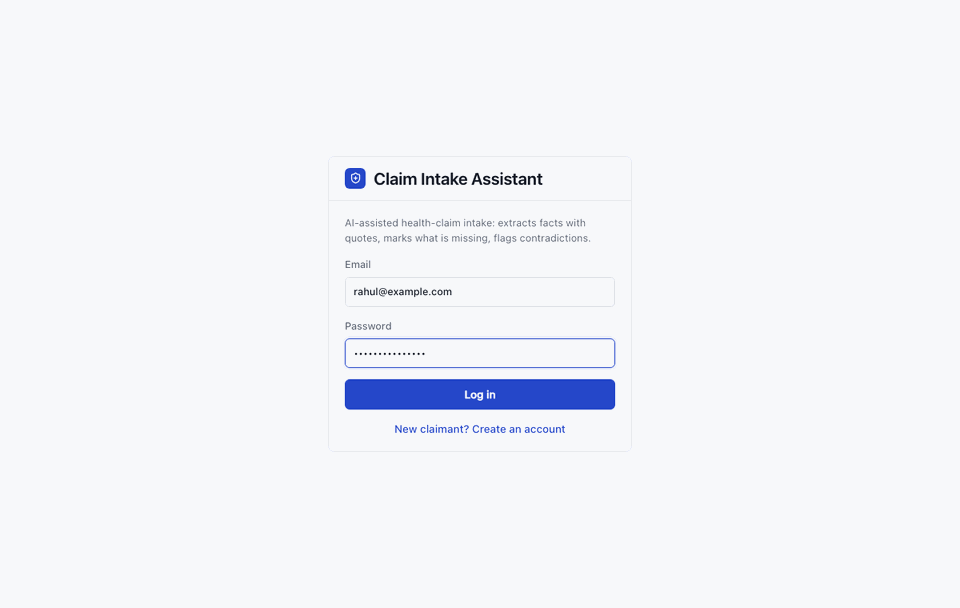
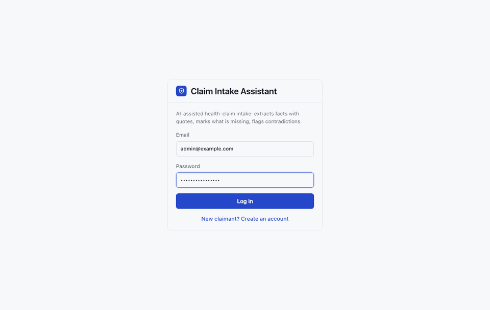
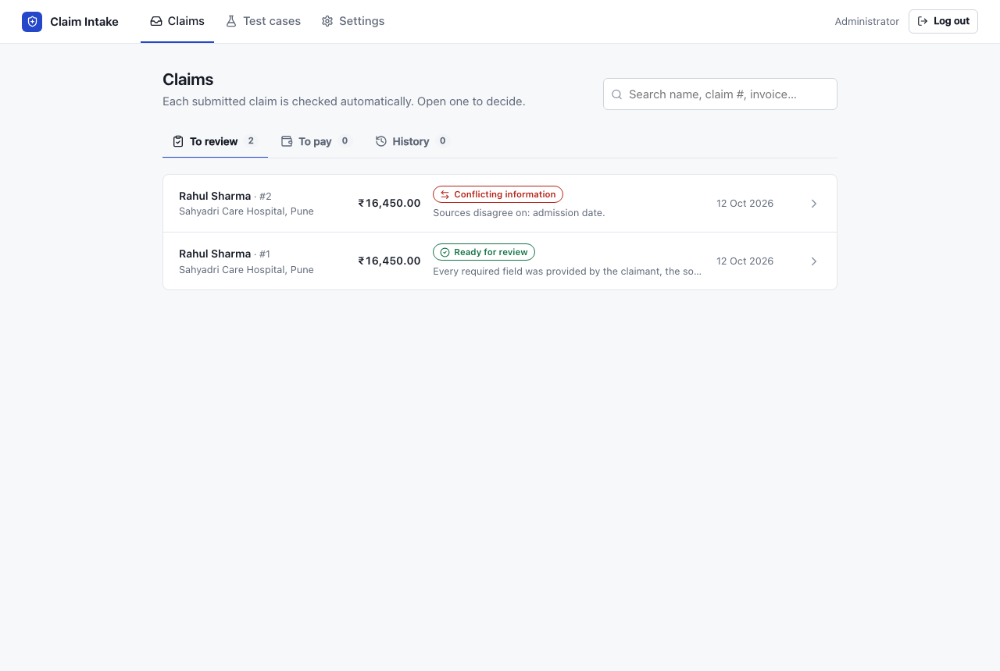
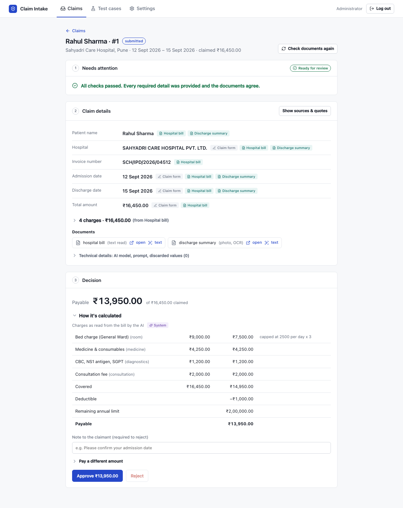

# Claim Intake Assistant: Frontend

React + TypeScript web app for an AI-assisted health-insurance claims intake system (India, INR). Claimants file a claim and upload their hospital documents; reviewers see what the AI found, what is missing and where documents disagree, then approve and pay.

The backend (FastAPI + PostgreSQL + Gemini) lives in the sibling repo [`Claim_Settlement_BD`](../Claim_Settlement_BD), which also has the full project documentation (architecture, schema, evaluation, failure cases).

| A claimant files a claim | A reviewer checks, approves and pays it |
|---|---|
|  |  |

**Contents:** [Setup guide](#setup-guide-backend--frontend) · [Configuration](#configuration-env) · [Screens](#screens) · [Screenshots](#screenshots) · [Design](#design) · [Project structure](#project-structure) · [Troubleshooting](#troubleshooting)

## Setup guide (backend + frontend)

The app needs the backend running. Both repos sit side by side:

```
Scout_Claim/
├── Claim_Settlement_BD/   ← backend (FastAPI, port 8000)
└── Claim_Settlement_FD/   ← this repo (React, port 5173)
```

### 1. Prerequisites

| Tool | Version | Check |
|---|---|---|
| Node.js | 20 or newer | `node --version` |
| Python | 3.11 or newer (backend) | `python3 --version` |
| PostgreSQL | 14 or newer (backend) | `psql --version` |
| Gemini API key | free, from [aistudio.google.com](https://aistudio.google.com) (backend) | |

### 2. Start the backend

Full details are in the [backend README](../Claim_Settlement_BD/README.md#setup-guide-backend--frontend). In short:

```bash
cd Claim_Settlement_BD
python3 -m venv .venv && source .venv/bin/activate
pip install -r requirements.txt
cp .env.example .env          # set DATABASE_URL, GEMINI_API_KEY, SECRET_KEY, ADMIN_EMAIL, ADMIN_PASSWORD
createdb claim_settlement
uvicorn app.main:app --reload # http://localhost:8000/health → {"status":"ok"}
```

### 3. Start the frontend

In a second terminal:

```bash
cd Claim_Settlement_FD
npm install
cp .env.example .env          # VITE_API_URL=http://localhost:8000
npm run dev
```

Open **http://localhost:5173**.

### 4. First walkthrough

1. **Log in as the reviewer** with `ADMIN_EMAIL` / `ADMIN_PASSWORD` from the backend `.env`.
2. **Create a claimant:** log out, click **"New claimant? Create an account"**, register.
3. **Give the claimant a policy:** as the reviewer, **Settings** → choose the claimant → policy number (e.g. `POL-26-0001`) → **Add policy**.
4. **File a claim as the claimant:** **My claims → New claim** → hospital, dates, total → upload the hospital bill and discharge summary (a sample bill is in `Claim_Settlement_BD/evals/files/`) → **Submit claim**. The AI check takes 5–60 seconds.
5. **Review:** as the reviewer, **Claims → To review** → open the claim → **Approve** → **To pay** → **Mark as paid**. The claimant sees *Paid*.

## Configuration (`.env`)

Copy `.env.example` to `.env`. Values in this file are built into the browser app, so they are public: never put secrets here.

| Variable | Default | Meaning |
|---|---|---|
| `VITE_API_URL` | `http://localhost:8000` | Address of the backend API. The browser calls it directly, so the backend's `CORS_ORIGINS` must include this app's address (`http://localhost:5173` by default). |

Leave `VITE_API_URL` empty (`VITE_API_URL=`) to use the dev server's proxy instead: requests to `/api` are forwarded to `BACKEND_URL` (default `http://localhost:8000`, see `vite.config.ts`), and no CORS setup is needed.

Restart `npm run dev` after changing `.env`.

## Scripts

```bash
npm run dev       # development server with hot reload (http://localhost:5173)
npm run build     # type-check + production build into dist/
npm run preview   # serve the production build locally
npm run lint      # oxlint
```

## Screens

| Route | Who | What |
|---|---|---|
| `#/my-claims` | Claimant | My claims, each with a progress line: Submitted → Under review → Approved → Paid |
| `#/claim/new`, `#/claim/:id` | Claimant | **3-step wizard:** 1. Your stay (hospital, dates, total) · 2. Documents (slots for hospital bill, discharge summary, other; drag & drop; "text read" feedback) · 3. Review & submit |
| `#/claims/review`, `#/claims/pay`, `#/claims/history` | Reviewer | **Claims inbox** with three tabs and search; each row shows the system's triage and why |
| `#/claim/:id` | Reviewer | **One claim, three blocks:** 1. Needs attention (conflicts, missing items, checks, suggested next steps) · 2. Claim details (every fact with its source; "Show sources & quotes"; documents) · 3. Decision (payable amount, how it's calculated, approve / reject, then mark as paid) |
| `#/test-cases` | Reviewer | Run the AI check on one of the 24 synthetic test claims (or pasted text) and compare with the expected result |
| `#/settings` | Reviewer | Give a claimant a policy |

### How the claim page shows the three rules

`src/components/ClaimSummary.tsx`

- **Nothing invented:** a field no source provides shows a dashed **Missing** badge, and block 1 lists each missing item (including missing documents) with the reason it is needed.
- **Claimant facts vs system output:** every value carries small source tags: **Claim form** (typed by the claimant), the document it was read from (e.g. **Hospital bill**), or purple **System** (expense categories, computed sums, triage, suggested next steps). "Show sources & quotes" shows every source's value with the exact quote it came from.
- **Conflicts are not resolved:** block 1 shows what each source says side by side, with the odd one out outlined; the field shows "Documents disagree" instead of a value, and the next steps tell the reviewer what to ask.

## Screenshots

**Reviewer: a claim whose documents disagree**


**Reviewer: inbox**


**Reviewer: clean claim with the settlement**


**Claimant: uploading documents**


**Claimant: my claims**


More: [login](docs/screenshots/01_login.png) · [claim step 1](docs/screenshots/03_claimant_step1_stay.png) · [test case runner](docs/screenshots/15_admin_test_case.png) · [dark mode](docs/screenshots/16_dark_mode_claim.png) · [phone width](docs/screenshots/18_phone_claimant.png)

## Design

- **Minimal and professional:** neutral surfaces, one blue accent, thin borders instead of shadows. Status colour is used for small marks and text, not large coloured areas.
- **Never colour alone:** every status has a colour, an icon ([Lucide](https://lucide.dev)) and a word.
- **Light and dark mode** follow the system setting; the layout works down to phone width.
- **Motion is kept to a minimum:** short hover and focus transitions, a spinner and loading placeholders. Anyone who turns on "reduce motion" gets none.
- **Amounts** use Indian digit grouping (₹1,24,600.00).
- No UI component library: plain React, Lucide icons, a small hash router (`src/router.ts`) and one stylesheet with design tokens (`src/index.css`).

## Project structure

```
src/
├── api.ts                    # fetch wrapper: login token, VITE_API_URL, readable error messages
├── types.ts                  # TypeScript types mirroring the backend schemas
├── format.ts                 # ₹ amounts, dates, labels, document names
├── router.ts                 # tiny hash router
├── App.tsx                   # top bar, navigation, routes per role
├── components/
│   ├── ui.tsx                # badges, triage chip, notices, spinner, skeleton, icons
│   └── ClaimSummary.tsx      # "Needs attention" and "Claim details" blocks
└── pages/
    ├── Login.tsx
    ├── admin/                # Inbox, ClaimPage, TestCases, Settings
    └── claimant/             # MyClaims, ClaimWizard, Progress
```

## Troubleshooting

| Problem | Fix |
|---|---|
| *"Cannot reach the server. Is the backend running on port 8000?"* | Start the backend, or fix `VITE_API_URL` in `.env` and restart `npm run dev`. |
| CORS error in the browser console | Add this app's address to `CORS_ORIGINS` in the backend `.env`, e.g. `["http://localhost:5173"]`, and restart the backend. Or set `VITE_API_URL=` to use the dev proxy. |
| Login works but pages are empty | The backend database was reset; log in again, and give the claimant a policy under **Settings**. |
| Claimant can't press **New claim** | They have no policy yet: the reviewer adds one under **Settings**. |
| A document shows *"could not be read"* | The backend could not reach Gemini or the daily quota is used up; see the [backend troubleshooting](../Claim_Settlement_BD/README.md#7-troubleshooting). |
| Port 5173 is busy | `npm run dev -- --port 5174`, and add `http://localhost:5174` to the backend's `CORS_ORIGINS`. |
